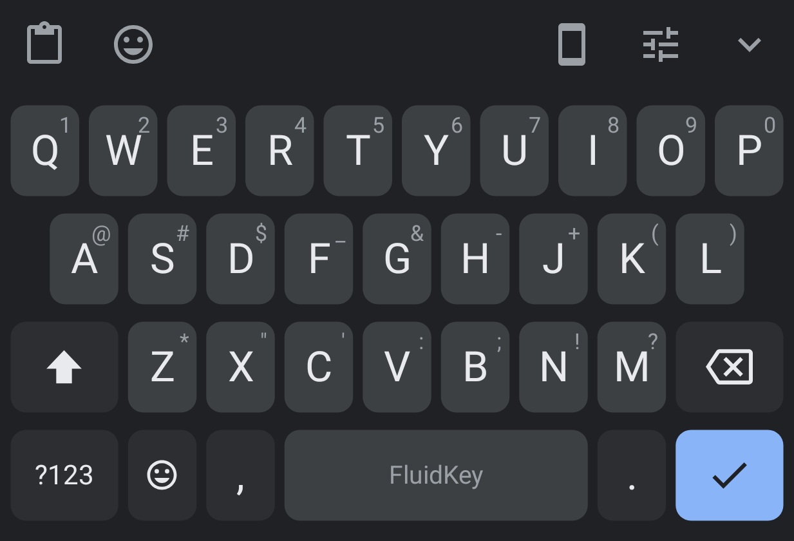
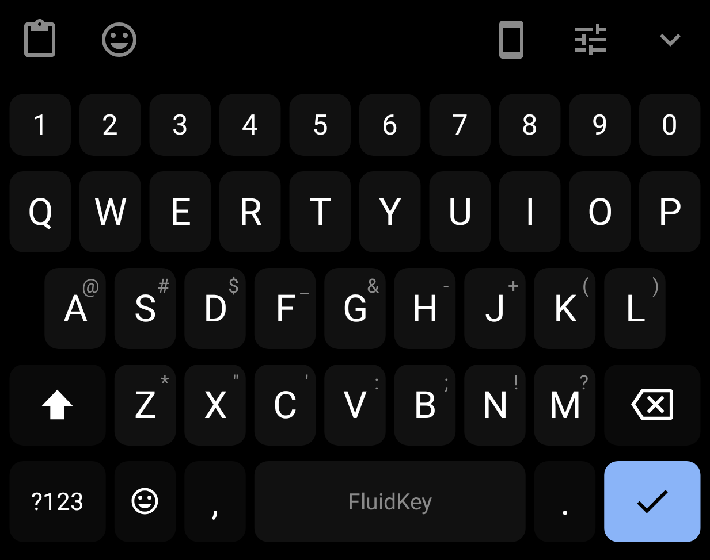
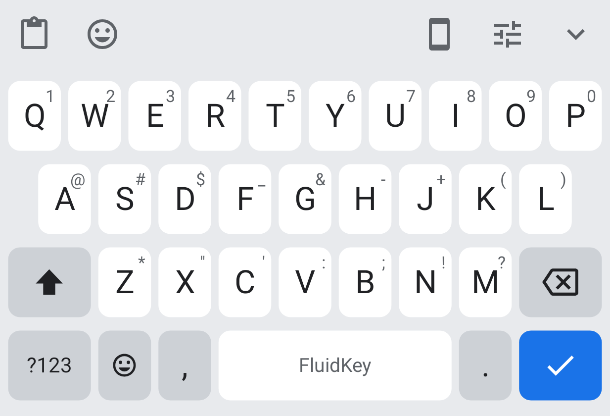
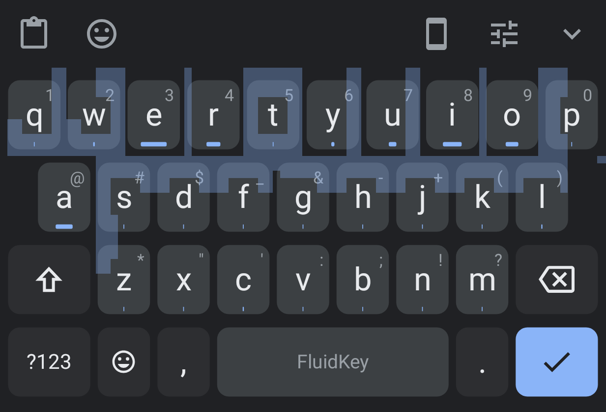
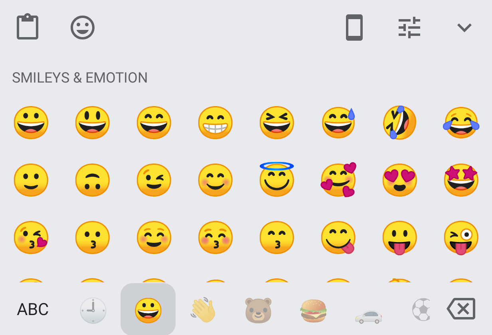
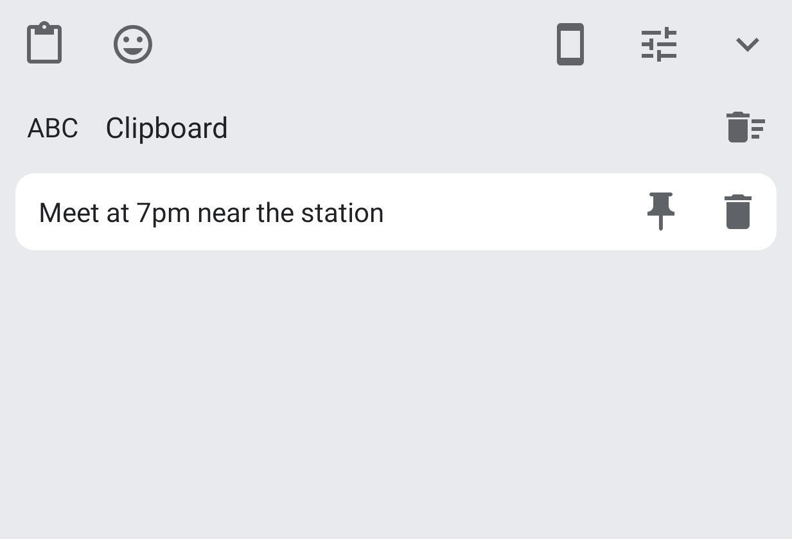

# FluidKey

**An Android keyboard that predicts your next letter and quietly enlarges its touch target, the
trick that makes the iOS keyboard feel like it never misses a keystroke.**

The keys you see never move. Behind them, every touch is resolved with a Bayesian decode of
*where* you touched and *what you are likely typing*. Anchored key cores guarantee every key
stays reachable. → [How it works (with research references)](docs/ADAPTIVE_TOUCH.md)

<p>



</p>
<p>



</p>

## Download

Grab **`FluidKey-v1.0.0.apk`** from [Releases](../../releases/latest) or from
[`release/`](release/) in this repo. Then:

1. Open the APK on your phone and allow installs from that source.
2. Open **FluidKey** → tap **1 · Enable** → switch FluidKey on.
3. Tap **2 · Select** and pick FluidKey. Use the text box on the same screen to try it.

Requires Android 8.0+ (API 26).

## Features

- **Adaptive hit targets.** Likely next letters grow into their neighbours' edges and unlikely
  ones shrink, while the visible keyboard stays the same. Adjustable strength, a debug hit-map
  overlay, and on-device learning of your personal aim and vocabulary.
- **Themes.** Follow system, AMOLED black, Light, Dark, Material You (wallpaper colours), Ocean,
  Forest, Sunset, Lavender, Rose. Optional borderless keys.
- **Keyboard size.** Height from 75% to 130%, plus a one-handed mode (left or right).
- **Number row** toggle.
- **Long-press symbols** with an adjustable delay (100–800 ms). Hints show on each key and accents
  are in the popups.
- **Clipboard.** History of copied text (sensitive clips such as passwords are skipped), pin,
  delete, clear, and a one-tap "paste what you just copied" chip.
- **Hold space and slide** to move the cursor, with adjustable speed. **Long-press space** to
  switch keyboards.
- **Swipe left from backspace** to select whole words, then release to delete them. Holding
  backspace accelerates, then deletes word by word.
- **Emoji panel** with categories and recents. Emoji the system font can't draw are hidden.
- Multi-touch rollover for fast two-thumb typing, key-press popups, haptics and sound,
  auto-capitalisation, double-space period, caps lock (double-tap shift), and number/phone pads for
  numeric fields.

## Build

```bash
./gradlew test assembleRelease
```

The output is `app/build/outputs/apk/release/app-release.apk`. CI
([`.github/workflows/release.yml`](.github/workflows/release.yml)) runs the tests, builds the APK
and publishes it as a GitHub release for the version in `app/build.gradle.kts`.

### Signing key

`keystore/fluidkey-release.jks` (password `fluidkey-public`) is committed **on purpose**. It is a
public sideload key, so any build from this repo can install as an update over a previous one. It
offers no secrecy: if you fork FluidKey and distribute it, generate your own key.

## Privacy

FluidKey has no internet permission. Learned words, aim offsets and clipboard history stay in
app-private storage on your device.

## Credits

- Word frequencies: [FrequencyWords](https://github.com/hermitdave/FrequencyWords) by Hermit Dave,
  derived from OpenSubtitles 2018 (CC-BY-SA-4.0).
- Emoji ordering and groups: [unicode-emoji-json](https://github.com/muan/unicode-emoji-json) (MIT).
- Icons: Material Symbols (Apache-2.0).
