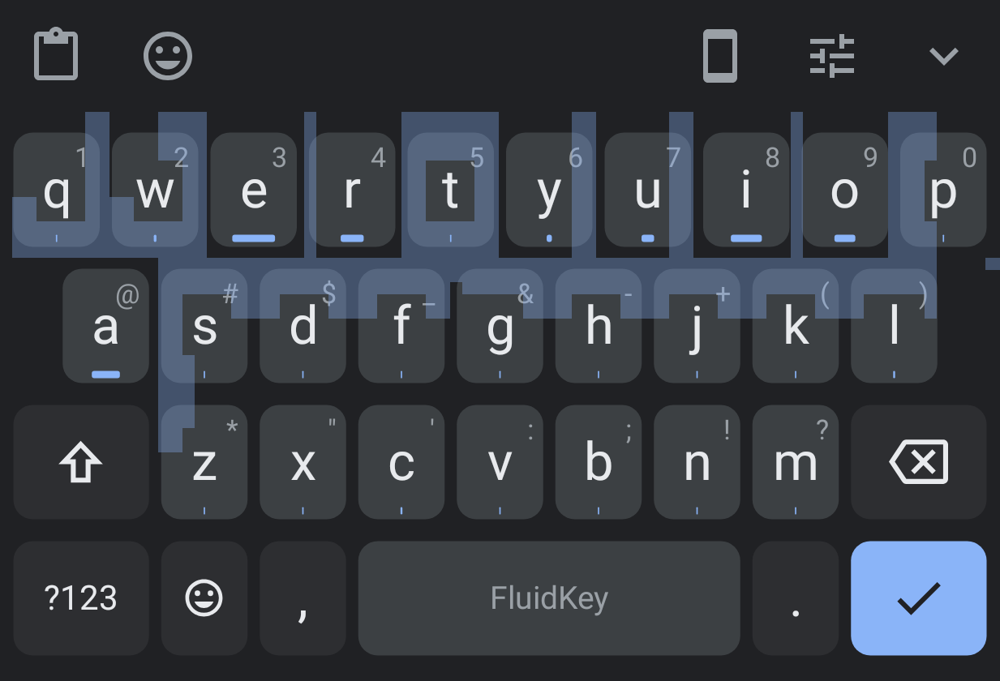

# Adaptive touch targets: how FluidKey decides which key you meant

The iOS keyboard feels like it "never misses" because the key you *see* is not the key you
*hit*. Behind the static key art, each letter's touch area grows or shrinks with every keystroke
depending on how likely that letter is to come next. FluidKey brings that technique to Android.
This note sums up the public research it is based on and how FluidKey implements it.

## What is publicly known

| Source | What it says |
|---|---|
| **Apple, US Patent 8,232,973**, *"Method, device, and graphical user interface providing word recommendations for text input"* (Kocienda et al., filed 2008, granted 2012) | The device keeps a history of touch points, predicts likely next characters from the text typed so far, and **enlarges the hit regions of predicted keys without changing the displayed keyboard**. Coverage at the time put it simply: when O is the expected next key, a touch landing between O and its neighbours still registers O. |
| **Ken Kocienda, *Creative Selection* (2018)** | First-hand account by the engineer who built the original iPhone keyboard, covering the dictionary-assisted typing that made a small glass keyboard usable. |
| **Gunawardana, Paek & Meek, *"Usability Guided Key-Target Resizing for Soft Keyboards"*, IUI 2010** (Microsoft Research, [PDF](https://www.microsoft.com/en-us/research/wp-content/uploads/2016/02/paper-final.pdf)) | Shows that *pure* probabilistic resizing can make some words impossible to type: an unlikely key gets swallowed by a likely neighbour. Their fix is **anchored dynamic key-targets**: every key keeps a guaranteed core area. That significantly cut keystroke errors versus both static keys and unanchored resizing. |
| **Goodman, Venolia, Steury & Parker, *"Language Modeling for Soft Keyboards"*, AAAI 2002** | Frames key decoding as Bayesian inference: `argmax_k P(touch | k) · P(k | context)`. A 2-D Gaussian touch model is combined with a character language model. |
| **Google Gboard** (Ouyang et al., *"Mobile Keyboard Input Decoding with Finite-State Transducers"*, 2017) | Same spatial-model + language-model idea at word level, used for autocorrection and gesture typing. |

Apple has never published the exact algorithm. The patent and the papers above describe the
same approach, and FluidKey follows it.

## FluidKey's algorithm

Implemented in [`AdaptiveTouchResolver.kt`](../app/src/main/java/dev/fluidkey/touch/AdaptiveTouchResolver.kt)
and [`NextCharPredictor.kt`](../app/src/main/java/dev/fluidkey/touch/NextCharPredictor.kt).
Every touch-down on the letter layout runs this:

1. **Geometric key.** Find the key whose touch cell contains the finger. Cells tile the whole
   keyboard, so gaps and edges belong to the nearest key and there are no dead zones.
2. **Anchor.** If the touch is inside the central 50% (width and height) of that key, it is that
   key, whatever the prediction says (Gunawardana 2010). Every key, and so every word, stays
   typeable.
3. **Bayesian decode.** Otherwise, score the touched key and each nearby letter `k`:

   ```
   score(k) = −½·[(dx/σx)² + (dy/σy)²]  +  λ · ln P(k | word-so-far)
   ```

   - `dx`, `dy` are measured from the key's centre **plus a learned per-key offset**, because people
     consistently hit some keys low or to one side.
   - `σ` is 0.5 of the key's width and height.
   - `λ` is the *Prediction strength* slider: 0 gives a classic keyboard, the default is 1.
4. **Bounds and margin.** A neighbour only wins if:
   - the touch is within 0.45 key widths of the neighbour's own cell, so targets never jump far; and
   - its score beats the touched key's by **0.5 nats** (about 1.65× more likely at equal distance),
     so two unlikely keys never swap edges over noise.
5. **Feedback matches the result.** The key preview and press highlight show the *resolved* key, so
   you see what will be typed.

### Where P(k | word-so-far) comes from

- A **prefix trie** over 40,000 English words weighted by `√frequency`. Frequencies come from
  [FrequencyWords](https://github.com/hermitdave/FrequencyWords), an OpenSubtitles 2018 word list
  (CC-BY-SA-4.0) that matches conversational typing well. Given the prefix `th`, P(e) is the weight
  of all words starting `the…` divided by the weight of all words continuing past `th`.
- A **letter trigram model** (interpolated with bigram/unigram), blended in according to how much
  dictionary evidence the prefix has. It covers names, slang and new words.
- A 1% uniform floor, so nothing is ever impossible.

### Learning

- **Aim offsets.** Each letter tap's position relative to the key centre is buffered. When the
  word is finished (space, punctuation, enter) **without a backspace**, those positions update that
  key's offset by a slow moving average (rate 0.03, capped at ±20% of the key). Taps that were
  re-assigned by prediction are excluded, so the model can't reinforce itself. A backspace throws
  the word's taps away.
- **Vocabulary.** Words you finish are added to a personal dictionary and boost the trie. This is
  skipped in password fields and in fields that request no personalised learning (incognito).
- **Back-off.** If you press backspace right after a touch that prediction re-assigned, prediction
  strength drops to 25% for the next 3 taps.
- **Privacy.** All of it stays on the device. *Settings → Reset learned data* wipes it.

### Seeing it

Turn on **Settings → Fluid touch → Show hit map**. Tinted areas are where the effective target
currently differs from the drawn key. A bar under each letter shows how likely it is next. Type
`th` and watch `e`, `a`, `i`, `o` reach into their neighbours while `t` and `q` shrink to their
anchors.



### Tests

[`AdaptiveTouchTest`](../app/src/test/java/dev/fluidkey/touch/AdaptiveTouchTest.kt) checks the
guarantees above:
- the anchor core always types its own key, for any context;
- λ = 0 behaves exactly like a static keyboard;
- expansion is bounded;
- a border touch after "th" resolves to `e`;
- learned offsets only change after words that were accepted without correction.

[`KeyboardEndToEndTest`](../app/src/test/java/dev/fluidkey/ime/KeyboardEndToEndTest.kt) drives the
real input-method service against a real `EditText` (Robolectric).
